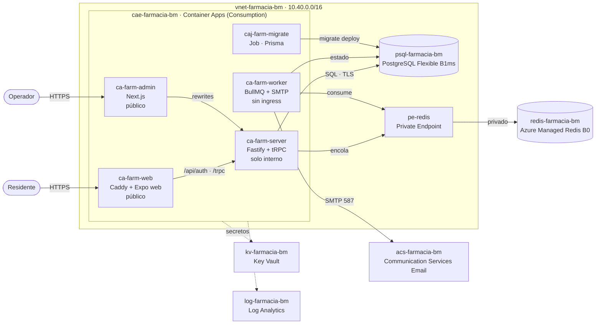

# Despliegue en Azure (pre-producción)

Arquitectura del ambiente de **pre-producción** en Azure, conectado a la rama `QA`. Prioriza el costo mínimo: sin VMs, con servicios gestionados y escalado a cero donde se puede. El diagrama completo, con costos y decisiones, está en [`farmacia-azure.html`](./farmacia-azure.html) (ábrelo en el navegador). El Bicep, los scripts y el paso a paso para desplegar y operar están en [`infra/README.md`](../../infra/README.md). Las imágenes y su configuración están descritas en [`../DEPLOYMENT.md`](../DEPLOYMENT.md).

Seguimiento: issue #38 (T-14).

## Ambientes y ramas

| Rama   | Ambiente       | Despliegue                                                               |
| ------ | -------------- | ------------------------------------------------------------------------ |
| `DEV`  | Integración    | Solo CI (lint, typecheck, tests, build). No se despliega en la nube.     |
| `QA`   | Pre-producción | Azure, resource group `rg-farmacia-bm`. Cada push a `QA` despliega.      |
| `main` | Producción     | Futuro ambiente separado: mismo Bicep, otro resource group y parámetros. |

Los cambios avanzan `DEV` → `QA` → `main` mediante pull requests. Ningún workflow despliega desde `DEV` ni desde `main` hacia el ambiente de pre-producción.

## Topología

- Solo `ca-farm-web` y `ca-farm-admin` reciben tráfico de internet, con TLS gestionado en `*.azurecontainerapps.io`.
- El navegador habla siempre con su propio origen: Caddy (web) y los _rewrites_ de Next (admin) reenvían `/api/auth/*` y `/trpc/*` al server. La cookie de sesión de Better Auth sigue siendo _first-party_, igual que en Docker Compose.
- PostgreSQL (subred delegada) y Redis (endpoint privado) no tienen IP pública.
- Las apps leen sus secretos desde Key Vault con la identidad gestionada `id-farmacia-bm`.

## Recursos

Región **Central US** para la red, PostgreSQL, Redis y Container Apps. Key Vault, la identidad y Log Analytics quedaron en East US 2 (funcionan entre regiones). El resource group `rg-farmacia-bm` ya existía (su metadata está en East US).

El plan original era East US 2, pero esta suscripción no permite PostgreSQL Burstable ahí (`SkuNotAvailable` en todas las zonas y también con B2s) y East US está restringida. Se probó B1ms en otras regiones y está disponible en Central US, South Central US, North Central US, West US 2 y Canada Central. Se eligió Central US por precio similar a East US 2.

| Recurso                   | Nombre                               | SKU / configuración                                                  |
| ------------------------- | ------------------------------------ | -------------------------------------------------------------------- |
| Red virtual               | `vnet-farmacia-bm`                   | `snet-aca` /27 (delegada a Container Apps), `snet-psql`, `snet-pe`   |
| Entorno de Container Apps | `cae-farmacia-bm`                    | Perfil Consumption, integrado a la VNet                              |
| App web del residente     | `ca-farm-web`                        | 0.25 vCPU / 0.5 GiB, ingress público, 0–2 réplicas                   |
| Backoffice                | `ca-farm-admin`                      | 0.25 vCPU / 0.5 GiB, ingress público, 0–2 réplicas                   |
| API                       | `ca-farm-server`                     | 0.5 vCPU / 1 GiB, ingress interno, 0–1 réplica                       |
| Worker                    | `ca-farm-worker`                     | 0.25 vCPU / 0.5 GiB, sin ingress, 1 réplica fija                     |
| Migraciones               | `caj-farm-migrate`                   | Job manual, `prisma migrate deploy`                                  |
| Datos de demo             | `caj-farm-seed`                      | Job manual con la imagen del server (`dist/scripts/seed.js`)         |
| PostgreSQL                | `psql-farmacia-bm`                   | Flexible Server Burstable B1ms, PG 18, 32 GB, backups 7 días, sin HA |
| Redis                     | `redis-farmacia-bm`                  | Azure Managed Redis Balanced B0, `NoCluster`, `NoEviction`, TLS      |
| Endpoint privado de Redis | `pe-redis-farmacia-bm`               | Zona DNS `privatelink.redis.azure.net`                               |
| Secretos                  | `kv-farmacia-bm`                     | Key Vault con RBAC                                                   |
| Identidad de las apps     | `id-farmacia-bm`                     | Identidad gestionada asignada por el usuario                         |
| Logs                      | `log-farmacia-bm`                    | Log Analytics, tope diario de 0.2 GB, retención 30 días              |
| Email                     | `acs-farmacia-bm`, `ecs-farmacia-bm` | Communication Services con dominio gestionado por Azure, SMTP        |
| Presupuesto               | `budget-farmacia-bm`                 | US$ 80/mes, alertas al 50, 80 y 100 % (real) y 100 % (pronóstico)    |

Azure Cache for Redis está en retiro y ya no permite crear cachés nuevas, por eso se usa Azure Managed Redis.

## Costo mensual estimado

| Recurso                                       |     US$/mes |
| --------------------------------------------- | ----------: |
| PostgreSQL Flexible B1ms + 32 GB              |         ~16 |
| Azure Managed Redis B0                        |         ~13 |
| Endpoint privado + 2 zonas DNS privadas       |          ~8 |
| Container Apps (worker siempre encendido)     |        6–18 |
| Log Analytics (con tope)                      |         0–3 |
| Key Vault, ACS Email, VNet, identidad         |         < 1 |
| GHCR + GitHub Actions                         |           0 |
| **Total en modo ahorro**                      | **≈ 50–60** |
| Modo demo (server, admin y web con 1 réplica) |     ≈ 70–85 |

Precios de lista aproximados de Central US, a confirmar en la calculadora de Azure. El tope acordado es US$ 100/mes.

## Flujo de release

Lo ejecuta `.github/workflows/deploy-qa.yml` solo en cada push a `QA`:

1. **Build:** GitHub Actions construye las 5 imágenes (server, worker, admin, mobile-web, migrate).
2. **Publicar:** las sube a GitHub Container Registry con el tag del commit.
3. **Migrar:** ejecuta `caj-farm-migrate`. Si falla, el pipeline se detiene sin tocar las apps.
4. **API:** actualiza `ca-farm-server` y `ca-farm-worker`.
5. **Frontends:** actualiza `ca-farm-admin` y `ca-farm-web` cuando la nueva revisión del server está lista.

Si la infraestructura todavía no existe, el workflow publica las imágenes y omite el despliegue con un aviso.

GitHub entra a Azure con una credencial federada (OIDC), limitada a `rg-farmacia-bm` y a la rama `QA`. No hay secretos de Azure de larga duración en el repositorio.

## Decisiones

- **Container Apps** para los cuatro servicios. Corre las mismas imágenes del compose, tiene ingress interno para el server, Jobs para las migraciones y escalado a cero.
- **mobile-web sigue siendo un contenedor con Caddy**, para mantener el proxy al mismo origen del que depende la cookie de sesión.
- **Datos en red privada.** Cuesta ~US$ 8/mes más y evita abrir los firewalls de Postgres y Redis.
- **Secretos en Key Vault** como referencias desde Container Apps. Ningún secreto queda en el workflow.

Descartadas:

- **Static Web Apps** para mobile-web: el plan Free no reenvía a un backend y el cruce de origen rompe las cookies `SameSite=Lax`.
- **App Service B1:** sale ~US$ 13 fijos, pero el server quedaría público y no hay Jobs para migrar.
- **Azure Functions:** no sirve para un worker de BullMQ que corre siempre ni para un servidor Fastify.

## Ajustes para Container Apps

Implementados junto con el Bicep:

1. **Caddyfile:** el proxy hacia la API reemplaza el `Host` por el nombre del upstream (`header_up Host {http.reverse_proxy.upstream.host}`), porque el ingress de Container Apps enruta por `Host`.
2. **Admin:** el workflow lo construye con `API_INTERNAL_URL=http://ca-farm-server` (queda fijo en el build).
3. **Conexiones:** Key Vault guarda `DATABASE_URL` con `sslmode=require` y `REDIS_URL=rediss://:<clave>@<host>:10000`.
4. **Auth:** `BETTER_AUTH_URL` = URL de web, `TRUSTED_ORIGINS` = web, admin y `bnp://`. `TRUST_PROXY_ADDRESSES=loopback,uniquelocal` se mantiene porque los proxies de Azure usan IPs privadas de la VNet.
5. **Email:** `infra/scripts/bootstrap.sh` crea la app de Entra del usuario SMTP. `EMAIL_FROM` usa `DoNotReply@<dominio>.azurecomm.net`.
6. **Suscripción:** `bootstrap.sh` registra el proveedor `Microsoft.Cache`.

## Riesgos

- **Arranque en frío:** con escalado a cero, la primera visita tarda ~5–15 s. Para las demos se activa el modo demo (1 réplica mínima) y después se apaga.
- **Redis B0:** admite `NoCluster` y `NoEviction`. El precio final está por confirmar. El plan B es Redis en un contenedor de Container Apps (~US$ 3, sin SLA).
- **Imágenes de GHCR:** el repositorio es público, pero los paquetes nuevos de GHCR se crean privados. Hay que hacerlos públicos o configurar un token `read:packages` en Key Vault.
- **Conexiones de Postgres:** B1ms admite ~35 conexiones de usuario. Por eso el server tiene máximo 1 réplica.
- **IP del cliente:** después del despliegue hay que verificar que el rate limiting (R-ACC-09) vea la IP real del cliente.
