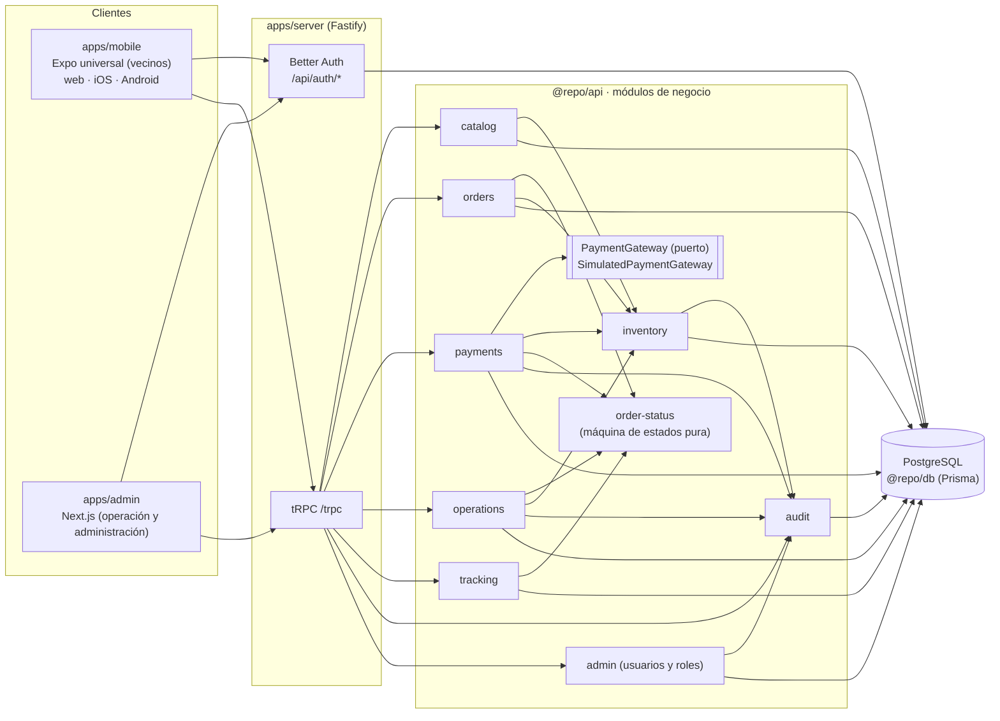
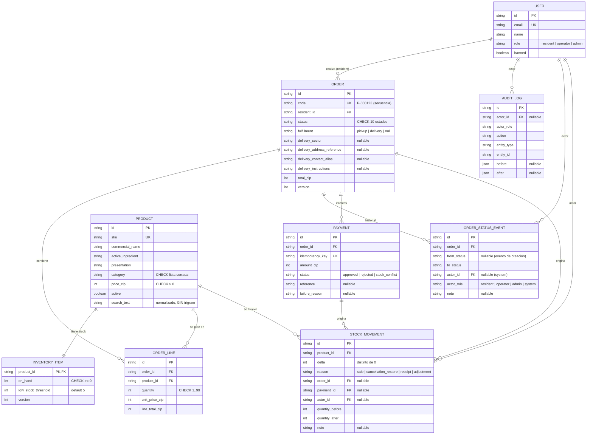

# Especificaciones por módulo

Estas especificaciones (specs) son el **contrato funcional** de cada módulo del MVP de la Farmacia Comunitaria de Peñalolén. Bajan a reglas verificables el informe de Inception v2.0 (4 de septiembre de 2026): requisitos RF-01..RF-12 y RNF-01..RNF-11, historias Must HU-01..HU-09, estados de la §4.6 y decisiones D-01..D-05.

- **Precedencia:** Inception v2.0 → decisiones de este documento (D-06 en adelante) → specs de módulo. Una spec nunca contradice el Inception: si lo precisa, lo hace mediante una decisión registrada abajo (D-01: los cambios se canalizan por el Product Backlog bajo la responsabilidad del Product Owner).
- **Alcance:** las historias **Must** (HU-01..HU-09, Sprints 1 y 2) y, desde el **Sprint 3**, las Should/Could HU-10..HU-14 (RF-13..RF-16), precisadas por las decisiones D-25..D-31. Cada una actualiza su spec de módulo en el PR que la implementa.
- **Mantención:** según la Definition of Done, cada historia actualiza su spec y la [matriz de trazabilidad](../traceability.md) en el mismo PR que cambia el comportamiento.

## Índice

| Spec                                    | Módulo (código)                                           | Historias           | Requisitos                                                | Issues        |
| --------------------------------------- | --------------------------------------------------------- | ------------------- | --------------------------------------------------------- | ------------- |
| [Catálogo](./catalog.md)                | `packages/api/src/modules/catalog`                        | HU-01               | RF-01, RF-02, RNF-01, RNF-02, RNF-04, RNF-06              | #10, #33      |
| [Cuentas y roles](./accounts-roles.md)  | `packages/auth`, `packages/api/src/trpc`, `modules/admin` | HU-02               | RF-03, RNF-05, RNF-06, RNF-07, RNF-09                     | #11, #26      |
| [Pedidos](./orders.md)                  | `packages/api/src/modules/orders`                         | HU-03, HU-04        | RF-04, RF-05, RNF-05, RNF-06, RNF-09                      | #12, #13      |
| [Estados del pedido](./order-status.md) | `packages/api/src/modules/order-status`                   | HU-05, HU-08, HU-09 | RF-07, RF-10, RF-12, RNF-07                               | #14, #17      |
| [Pagos simulados](./payments.md)        | `packages/api/src/modules/payments`                       | HU-05, HU-06        | RF-06, RF-07, RF-08, RNF-08, RNF-11                       | #14, #15      |
| [Inventario](./inventory.md)            | `packages/api/src/modules/inventory`                      | HU-06, HU-10, HU-12 | RF-07, RF-08, RF-12, RF-13, RF-15, RNF-07, RNF-08, RNF-11 | #15, #19, #21 |
| [Operación](./operations.md)            | `packages/api/src/modules/operations`                     | HU-07, HU-08        | RF-09, RF-10, RF-12, RNF-05, RNF-07                       | #16, #17      |
| [Seguimiento](./tracking.md)            | `packages/api/src/modules/tracking`                       | HU-09               | RF-11, RNF-05, RNF-06                                     | #18           |
| [Auditoría](./audit.md)                 | `packages/api/src/modules/audit`                          | HU-06, HU-08        | RF-12, RNF-07                                             | #15, #17      |
| [Reportes](./reports.md)                | `packages/api/src/modules/reports`                        | HU-13               | RF-16, RNF-05, RNF-06                                     | #22           |

Diagramas UML: Mermaid dentro de cada spec (se ven en GitHub) y fuentes PlantUML en [`docs/uml`](../uml/README.md).

## Convenciones comunes

### Roles y tipos de procedimiento

| Rol        | Quién es (Inception §2.2–2.3, D-06)                                                  |
| ---------- | ------------------------------------------------------------------------------------ |
| (anónimo)  | Persona interesada sin sesión: solo catálogo público.                                |
| `resident` | Persona inscrita con cuenta sintética preinscrita. Rol por defecto.                  |
| `operator` | Funcionario autorizado: farmacia, bodega o delivery. Opera la bandeja y los estados. |
| `admin`    | Administrador del programa: todo lo de `operator` + usuarios/roles + auditoría.      |

| Procedimiento tRPC   | Exige                    | Sin sesión     | Rol no permitido |
| -------------------- | ------------------------ | -------------- | ---------------- |
| `publicProcedure`    | nada                     | —              | —                |
| `protectedProcedure` | sesión (cualquier rol)   | `UNAUTHORIZED` | —                |
| `residentProcedure`  | rol `resident`           | `UNAUTHORIZED` | `FORBIDDEN`      |
| `operatorProcedure`  | rol `operator` o `admin` | `UNAUTHORIZED` | `FORBIDDEN`      |
| `adminProcedure`     | rol `admin`              | `UNAUTHORIZED` | `FORBIDDEN`      |

### Errores

Los servicios lanzan `AppError` (`@repo/shared`); un middleware lo traduce a `TRPCError`. Los mensajes son en español de Chile, dicen qué pasó y cómo continuar, y nunca exponen detalles internos (RNF-09).

| Código         | Cuándo se usa                                                                                                       |
| -------------- | ------------------------------------------------------------------------------------------------------------------- |
| `BAD_REQUEST`  | Entrada inválida según el schema zod (el cliente recibe `data.zodError` con el campo que falló).                    |
| `UNAUTHORIZED` | Falta sesión.                                                                                                       |
| `FORBIDDEN`    | La sesión no tiene el rol requerido por el procedimiento.                                                           |
| `NOT_FOUND`    | El recurso no existe **o pertenece a otra cuenta** (D-10).                                                          |
| `CONFLICT`     | Regla de negocio o de concurrencia: transición inválida, versión desactualizada, falta de stock, clave reutilizada. |
| `INTERNAL`     | Error inesperado. El cliente recibe un mensaje genérico; el detalle va solo al log estructurado.                    |

Cuando un `CONFLICT` necesita datos para la interfaz, `AppError.details` lleva un discriminador `reason` (por ejemplo `STOCK_CONFLICT`, `STALE_VERSION`, `INVALID_TRANSITION`, `IDEMPOTENCY_KEY_REUSED`) y el mensaje en español ya es suficiente para la persona. El formateador de errores de tRPC (`packages/api/src/trpc/error-formatter.ts`) publica solo ese discriminador al cliente como `data.reason` (`null` si no hay, y siempre `null` en errores internos); el resto de `details` queda en el servidor.

### Otras convenciones

- **Dinero:** pesos chilenos (CLP) como enteros (`Int`), sin decimales. Todos los totales se calculan en el servidor.
- **Fecha y hora:** `timestamptz` en UTC en la base de datos; los clientes las muestran en `America/Santiago` (D-23).
- **Paginación:** por cursor opaco (`{ cursor?, limit }`, `nextCursor: string | null`).
- **Datos:** solo sintéticos (RNF-06, D-04). Ningún log, seed ni evidencia contiene datos reales ni credenciales.
- **Validación:** toda entrada externa pasa por zod en el borde (`<modulo>.schema.ts`).
- **Pruebas:** pirámide de pruebas (OE-06, RNF-10). Unitarias en `*.test.ts` junto al código, integración sobre PostgreSQL real en `*.int.test.ts` (T-05, #28), E2E con Playwright en `apps/e2e/src/**` (T-08, #31).

## Vista de conjunto

### Componentes



Cada módulo sigue `router → service → repository` y usa a otro módulo solo a través de su `index.ts` (ver [REPO_RULES §3.3](../REPO_RULES.md)). La lógica de negocio depende del puerto `PaymentGateway`, no del simulador (RNF-11).

### Modelo de datos (entidad-relación)



Todas las tablas tienen `created_at` (y `updated_at` donde se actualizan), siempre `timestamptz`. Un pedido puede no tener líneas (el borrador empieza vacío). Dos índices únicos parciales, que el diagrama no puede dibujar, sostienen invariantes del dominio: `orders_one_draft_per_resident (resident_id) WHERE status = 'draft'` (R-DAT-04) y `payments_one_approved_per_order (order_id) WHERE status = 'approved'` (R-DAT-05); el detalle está en [data-model.md](./data-model.md) y en [`docs/uml/er.puml`](../uml/er.puml). Nombres en `snake_case` (`@@map`); los valores cerrados (estado, modalidad, categoría, motivo, rol del actor) se guardan como texto con `CHECK` y se tipan en TypeScript con uniones `as const` (sin `enum`). La implementación del modelo es la tarea T-01 (#24).

## Plantilla de spec

Cada spec usa exactamente estas secciones (si una no aplica, se escribe “No aplica” y por qué):

```markdown
# <Nombre del módulo>

> Módulo: `<ruta>` · Historias: HU-xx · Issues: #N · Estado: Borrador v1 (Sprint 1)

## 1. Propósito

## 2. Actores y roles

## 3. Reglas de negocio

1. **R-<MOD>-01.** Regla verificable. _(RF-xx, RNF-xx, D-xx)_

## 4. Estados y transiciones

## 5. API

| Procedimiento | Tipo | Acceso | Entrada | Salida | Errores |

## 6. Datos

## 7. Casos de prueba

| ID | Nivel (unit / int / e2e) | Caso | Criterio cubierto | Archivo esperado |

## 8. Trazabilidad

| Requisito | Historia | Reglas | Pruebas |
```

## Registro de decisiones (refinamientos del Inception)

Las decisiones D-01..D-05 están en el Inception (§13). Las siguientes **precisan** el Inception para poder implementarlo y probarlo; no agregan alcance. Estado de todas: _adoptada por el equipo, pendiente de validación del Product Owner (D-01)_.

| ID   | Decisión                                                                                                                                                                                                                                                                                                                                                                                                                                                                                                                                                                           | Precisa                              | Specs                                  |
| ---- | ---------------------------------------------------------------------------------------------------------------------------------------------------------------------------------------------------------------------------------------------------------------------------------------------------------------------------------------------------------------------------------------------------------------------------------------------------------------------------------------------------------------------------------------------------------------------------------- | ------------------------------------ | -------------------------------------- |
| D-06 | Tres roles: `resident` (por defecto), `operator` (farmacia, bodega y delivery: el “funcionario autorizado”) y `admin` (todo lo de `operator` + usuarios/roles + auditoría).                                                                                                                                                                                                                                                                                                                                                                                                        | §2.2–2.3, RF-03, RNF-05              | accounts-roles, operations             |
| D-07 | No hay registro público: las cuentas sintéticas se crean por seed (supuesto §5.1). El inicio de sesión fallido muestra siempre el mismo mensaje genérico.                                                                                                                                                                                                                                                                                                                                                                                                                          | §4.1 punto 2, HU-02                  | accounts-roles                         |
| D-08 | El borrador no reserva stock. La disponibilidad (`on_hand`) se valida al agregar, al confirmar y, de forma atómica, al aprobarse el pago, que es el único momento en que se descuenta.                                                                                                                                                                                                                                                                                                                                                                                             | D-02, RF-04, RF-07                   | orders, inventory, payments            |
| D-09 | Si al aprobarse el pago otra operación consumió el stock: no se descuenta nada, el intento queda como `stock_conflict`, se audita `payment.stock_conflict` con los productos afectados, el pedido **conserva su estado** y la persona recibe `CONFLICT` con la lista de productos. Puede reintentar (nueva clave) o cancelar el pedido.                                                                                                                                                                                                                                            | HU-06 criterio 2, RNF-08             | payments, inventory, audit             |
| D-10 | Consultar un pedido de otra cuenta responde `NOT_FOUND`, igual que uno inexistente, para no revelar qué pedidos existen. Abrir la bandeja sin rol operativo responde `FORBIDDEN`.                                                                                                                                                                                                                                                                                                                                                                                                  | HU-09 criterio 2, HU-07 criterio 2   | tracking, orders, payments, operations |
| D-11 | Tras un pago rechazado la persona puede reintentar con un nuevo intento: `payment_rejected → payment_validated` o `payment_rejected → payment_rejected` (evento `system`).                                                                                                                                                                                                                                                                                                                                                                                                         | §4.6, HU-05                          | order-status, payments                 |
| D-12 | Idempotencia: el cliente genera una clave UUID por intento y la reutiliza si repite ese intento. Una clave ya usada devuelve el resultado guardado sin efectos; usada en otro pedido responde `CONFLICT`. Si el pedido ya tiene pago validado, se devuelve el pago aprobado existente (nunca un segundo descuento).                                                                                                                                                                                                                                                                | HU-05 criterio 3, RF-07, RNF-08      | payments                               |
| D-13 | El simulador de pago es determinista: el resultado es el escenario elegido explícitamente en la interfaz (“Simular pago aprobado” / “Simular pago rechazado”) y está detrás del puerto `PaymentGateway`.                                                                                                                                                                                                                                                                                                                                                                           | RF-06, RNF-11, §4.4                  | payments                               |
| D-14 | Cancelación: el dueño o la operación pueden cancelar en `draft`, `pending_payment`, `payment_rejected` y `payment_validated` (este último restaura el stock automáticamente, D-02). Desde `in_preparation` no se cancela en el Must. `not_delivered` pasa a `in_transit` (reintento) o a `cancelled` **sin** restauración automática.                                                                                                                                                                                                                                              | §4.6, D-02                           | order-status, operations, inventory    |
| D-15 | Concurrencia optimista: toda transición es un _compare-and-set_ sobre estado y `version`; si el pedido cambió, responde `CONFLICT` y no modifica nada.                                                                                                                                                                                                                                                                                                                                                                                                                             | §4.6 “conservará el estado anterior” | order-status, operations               |
| D-16 | Un único borrador por persona (su “carrito”). El precio unitario se captura al agregar y se refresca al confirmar; el total se calcula en el servidor. Cantidad por línea: 1..99 y nunca mayor que la disponibilidad.                                                                                                                                                                                                                                                                                                                                                              | RF-04, HU-03                         | orders                                 |
| D-17 | La disponibilidad se informa en tres niveles: disponible, pocas unidades (`on_hand` ≤ umbral del producto, por defecto 5) y agotado; siempre con texto e ícono, no solo color.                                                                                                                                                                                                                                                                                                                                                                                                     | RF-02, RNF-01                        | catalog, inventory                     |
| D-18 | La bandeja operativa ordena del más antiguo al más reciente (FIFO) por el instante de confirmación del pedido (`orders.created_at`, re-sellado al salir de borrador, R-DAT-11) y excluye borradores por defecto.                                                                                                                                                                                                                                                                                                                                                                   | RF-09, HU-07                         | operations                             |
| D-19 | La línea de tiempo de la persona muestra el rol del actor (“Farmacia”, “Sistema”…), nunca datos personales del funcionario.                                                                                                                                                                                                                                                                                                                                                                                                                                                        | RF-11, RNF-06, R-05                  | tracking                               |
| D-20 | `orders.mine` es un listado mínimo para llegar al detalle de HU-09. El “historial de pedidos” ampliado (Should, §4.2) no se construye; repetir pedidos (HU-14) entra en el Sprint 3 (D-30).                                                                                                                                                                                                                                                                                                                                                                                        | HU-09, §4.2                          | tracking                               |
| D-21 | El Inception excluye “aplicaciones móviles nativas” (§4.4). El cliente de vecinos es Expo universal ([ADR 0002](../adr/0002-clientes-expo-universal-y-admin.md)); la aceptación del MVP se evalúa en su **exportación web** (RNF-03). Los binarios iOS/Android son un subproducto sin compromiso de alcance. **Requiere confirmación del PO.**                                                                                                                                                                                                                                     | §4.4, RNF-03                         | todas las de cliente                   |
| D-22 | La auditoría se escribe en la misma transacción que el cambio auditado (si el cambio se revierte, su registro también) y la consulta solo el rol `admin`.                                                                                                                                                                                                                                                                                                                                                                                                                          | RF-12, RNF-07, §4.1 punto 9          | audit                                  |
| D-23 | Fechas en UTC (`timestamptz`) en la base de datos, en todas las tablas (incluidas las de Better Auth); las interfaces las muestran en hora de Chile (`America/Santiago`).                                                                                                                                                                                                                                                                                                                                                                                                          | RF-12 “fecha y hora”                 | todas                                  |
| D-24 | Better Auth solo expone por HTTP los endpoints que usan las apps (`AUTH_HTTP_PATHS`: sign-in, sign-out, get-session, sign-up deshabilitado y `admin/create-user` solo para cuentas `resident`); el resto responde 404. Los cambios de rol pasan solo por `admin.setRole` (auditado) y ninguna cuenta se borra ni se suplanta, para no perder el actor del historial. El inicio de sesión se limita por IP y por par cuenta + IP (no solo por cuenta, para que nadie pueda bloquear a operadores o administradores), en JSON y urlencoded, fallando cerrado si no se lee el correo. | RF-12, RNF-05, RNF-07, §4.1 punto 9  | accounts-roles, audit                  |
| D-25 | Recepciones y ajustes (HU-10) los registra `operator` o `admin` desde el backoffice. Recepción: suma unidades (`delta > 0`). Ajuste: corrige en cualquier sentido (`delta ≠ 0`). El motivo es obligatorio (5 a 280 caracteres) y se guarda en `stock_movements.note`. Un ajuste que dejaría stock negativo se rechaza sin modificar nada. El movimiento y su auditoría (`stock.receipt` / `stock.adjustment`, `{ onHand }` antes / después) se escriben en la misma transacción, con el mismo bloqueo de filas que el descuento por pago.                                          | RF-13, RNF-07, HU-10                 | inventory, audit                       |
| D-26 | El umbral de stock bajo es por producto (entero 0..999, por defecto 5). Lo cambia `operator` o `admin` y se audita como `inventory.threshold_change` (`{ lowStockThreshold }`).                                                                                                                                                                                                                                                                                                                                                                                                    | RF-15, HU-12                         | inventory, audit                       |
| D-27 | Alertas de stock bajo (HU-12): un producto activo aparece en el listado cuando `on_hand ≤ low_stock_threshold`; agotados primero, luego por unidades disponibles. Es una consulta en el backoffice, sin notificaciones push ni correo.                                                                                                                                                                                                                                                                                                                                             | RF-15, HU-12                         | inventory                              |
| D-28 | Mantención del catálogo (HU-11): solo `admin` crea y edita productos (datos, precio en CLP > 0 y activo/inactivo); no se borran productos, se desactivan. Un producto nuevo parte con stock 0 y el umbral por defecto. Un cambio de precio no altera pedidos ya confirmados (precio capturado, D-16); los borradores lo toman al confirmar. Se audita `product.create` / `product.update` con el producto antes / después.                                                                                                                                                         | RF-14, RNF-05, HU-11                 | catalog, audit                         |
| D-29 | Reportes (HU-13, solo `admin`): unidades dispensadas (suma de unidades de pedidos entregados o retirados en el rango), pedidos por estado y productos bajo umbral (D-27). Rango por defecto: últimos 30 días; máximo 1 año. Solo datos sintéticos agregados, sin datos personales.                                                                                                                                                                                                                                                                                                 | RF-16, RNF-06, HU-13                 | reports                                |
| D-30 | Repetir pedido (HU-14): la persona elige un pedido propio ya confirmado y sus productos se **suman** a su borrador actual. Cada cantidad se ajusta a la disponibilidad actual y al máximo de 99; los productos agotados o inactivos se omiten. La respuesta informa cada cambio (reducido, agotado, inactivo) y la app lo muestra en el carrito. El precio se toma del catálogo actual.                                                                                                                                                                                            | HU-14, D-16                          | orders, tracking                       |
| D-31 | Permisos del Sprint 3 en la matriz de `@repo/shared`: `inventory: read, adjust` para `operator` y `admin`; `catalog: write` y `reports: read` solo para `admin`.                                                                                                                                                                                                                                                                                                                                                                                                                   | RNF-05                               | accounts-roles                         |

Una decisión nueva se agrega al final con el siguiente número, se enlaza desde las specs afectadas y se comenta en el issue de la historia correspondiente.
