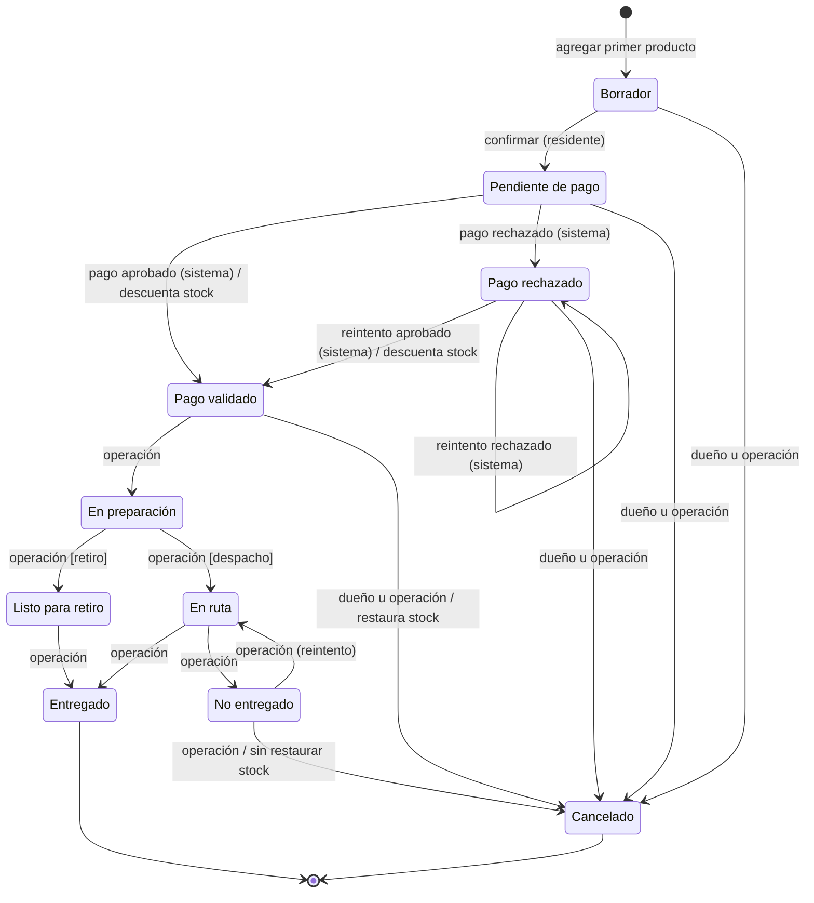

# Estados del pedido (máquina de estados)

> Módulo: `packages/api/src/modules/order-status` (lógica pura, sin E/S) · Historias: HU-05, HU-08, HU-09 · Issues: #14, #17 · Estado: Borrador v1 (Sprint 1)

## 1. Propósito

Ser la **única** fuente de verdad de qué transiciones de estado son válidas, para qué actor y con qué efecto (Inception §4.6, D-03). Pedidos, pagos, operación y seguimiento la usan a través de su `index.ts`; ningún otro módulo decide transiciones por su cuenta.

## 2. Actores y roles

| Actor (`actorRole`) | Quién                                          | Transiciones que dispara                                |
| ------------------- | ---------------------------------------------- | ------------------------------------------------------- |
| `resident`          | Dueño del pedido                               | Confirmar y cancelar (estados previos a la preparación) |
| `system`            | Resultado de un evento interno (pago simulado) | Estados de pago (D-03)                                  |
| `operator`, `admin` | Funcionario autorizado                         | Estados físicos y cancelaciones operativas              |

## 3. Reglas de negocio

1. **R-OST-01.** Estados cerrados (`as const`) con etiqueta en español: `draft` Borrador, `pending_payment` Pendiente de pago, `payment_validated` Pago validado, `payment_rejected` Pago rechazado, `in_preparation` En preparación, `ready_for_pickup` Listo para retiro, `in_transit` En ruta, `delivered` Entregado, `not_delivered` No entregado, `cancelled` Cancelado. _(§4.6)_
2. **R-OST-02.** Solo son válidas las transiciones de la tabla de la sección 4, para el actor indicado y con su condición. Cualquier otra combinación (estado, destino, actor) es inválida. _(RF-10, §4.6)_
3. **R-OST-03.** Una transición inválida se rechaza con `CONFLICT` (`reason: "INVALID_TRANSITION"`) y **conserva el estado anterior**: no cambia el pedido, no escribe eventos ni movimientos. _(RF-10, HU-08 criterio 2, §4.6)_
4. **R-OST-04.** Los estados de pago los registra solo el actor `system` (como efecto de `payments.pay`); los estados físicos solo `operator`/`admin`. _(D-03, §4.6 “Solo un rol autorizado…”)_
5. **R-OST-05.** `in_preparation → ready_for_pickup` exige modalidad `pickup`; `in_preparation → in_transit` exige `delivery`. _(§4.5 paso 8, RF-05)_
6. **R-OST-06.** Toda transición aplicada es un _compare-and-set_: `UPDATE orders SET status = :to, version = version + 1 … WHERE id = :id AND status = :from AND version = :expectedVersion`. Si no actualiza ninguna fila, responde `CONFLICT` (`STALE_VERSION`) y no hay efectos. _(D-15, RNF-08)_
7. **R-OST-07.** Toda transición aplicada escribe, en la misma transacción, un `OrderStatusEvent` (`from_status`, `to_status`, `actor_id`, `actor_role`, `note`, `created_at`) y un `AuditLog` `order.transition` con estado anterior y nuevo. _(RF-12, RNF-07, D-22)_
8. **R-OST-08.** Efectos de stock ligados a transiciones: `→ payment_validated` descuenta una sola vez (ver [Pagos](./payments.md)); `payment_validated → cancelled` restaura automáticamente; `not_delivered → cancelled` **no** restaura (la corrección es un ajuste manual, HU-10, Should). _(D-02, D-14)_
9. **R-OST-09.** `payment_rejected → payment_rejected` es una transición válida (nuevo intento rechazado) y también queda en el historial. _(D-11)_
10. **R-OST-10.** El módulo expone funciones puras y exhaustivamente probadas: `canTransition`, `assertTransition` (lanza `AppError`), `allowedTransitions` (para mostrar solo botones válidos) y `statusLabel`. _(RF-10, RNF-10)_

## 4. Estados y transiciones

| #   | Desde               | Hacia               | Actor                                 | Condición / efecto                                                       |
| --- | ------------------- | ------------------- | ------------------------------------- | ------------------------------------------------------------------------ |
| T1  | `draft`             | `pending_payment`   | `resident` dueño                      | `orders.confirm`: ≥ 1 línea, modalidad válida, disponibilidad revalidada |
| T2  | `pending_payment`   | `payment_validated` | `system`                              | Pago aprobado y stock suficiente: descuento atómico (`sale`)             |
| T3  | `pending_payment`   | `payment_rejected`  | `system`                              | Pago rechazado: stock sin cambios                                        |
| T4  | `payment_rejected`  | `payment_validated` | `system`                              | Nuevo intento aprobado y stock suficiente: descuento atómico             |
| T5  | `payment_rejected`  | `payment_rejected`  | `system`                              | Nuevo intento rechazado                                                  |
| T6  | `payment_validated` | `in_preparation`    | `operator`, `admin`                   | —                                                                        |
| T7  | `in_preparation`    | `ready_for_pickup`  | `operator`, `admin`                   | Solo si modalidad `pickup`                                               |
| T8  | `in_preparation`    | `in_transit`        | `operator`, `admin`                   | Solo si modalidad `delivery`                                             |
| T9  | `ready_for_pickup`  | `delivered`         | `operator`, `admin`                   | —                                                                        |
| T10 | `in_transit`        | `delivered`         | `operator`, `admin`                   | —                                                                        |
| T11 | `in_transit`        | `not_delivered`     | `operator`, `admin`                   | Queda disponible para resolución operativa                               |
| T12 | `not_delivered`     | `in_transit`        | `operator`, `admin`                   | Reintento de despacho                                                    |
| T13 | `not_delivered`     | `cancelled`         | `operator`, `admin`                   | **Sin** restauración automática de stock (D-14)                          |
| T14 | `draft`             | `cancelled`         | `resident` dueño, `operator`, `admin` | —                                                                        |
| T15 | `pending_payment`   | `cancelled`         | `resident` dueño, `operator`, `admin` | —                                                                        |
| T16 | `payment_rejected`  | `cancelled`         | `resident` dueño, `operator`, `admin` | —                                                                        |
| T17 | `payment_validated` | `cancelled`         | `resident` dueño, `operator`, `admin` | Restaura stock automáticamente (`cancellation_restore`, D-02)            |

Estados terminales: `delivered` y `cancelled`.

Fuente PlantUML: [`docs/uml/order-states.puml`](../uml/order-states.puml).

## 5. API

No expone procedimientos tRPC. API interna (vía `index.ts`), pura y sin dependencias de BD:

| Función                                                               | Devuelve                                                                 | Uso                                         |
| --------------------------------------------------------------------- | ------------------------------------------------------------------------ | ------------------------------------------- |
| `canTransition({ from, to, actorRole, isOwner, fulfillment })`        | `boolean`                                                                | Validación sin excepción                    |
| `assertTransition({ from, to, actorRole, isOwner, fulfillment })`     | `void` o lanza `AppError("CONFLICT")` con `reason: "INVALID_TRANSITION"` | Servicios antes del _compare-and-set_       |
| `allowedTransitions({ status, actorRole, isOwner, fulfillment })`     | `OrderStatus[]`                                                          | Botones del backoffice (`operations.order`) |
| `statusLabel(status)`                                                 | `string` (español)                                                       | Respuestas de seguimiento y bandeja         |
| `ORDER_STATUSES`, `type OrderStatus`, `ACTOR_ROLES`, `type ActorRole` | constantes `as const`                                                    | Schemas zod y tipos                         |

Las listas de estados y etiquetas que necesitan los clientes se exponen como valores en `@repo/shared` (los clientes no importan valores de `@repo/api`), o se entregan ya resueltas en las respuestas (`statusLabel`).

## 6. Datos

- `orders.status`: texto con `CHECK (status IN (…10 estados…))`; `orders.version`: `Int`.
- `order_status_events`: `id` PK, `order_id` FK (`CASCADE`), `from_status`, `to_status` (ambos con `CHECK`), `actor_id` FK → `user` (nulo para `system`), `actor_role` (`resident | operator | admin | system`, `CHECK`), `note` (nulo, ≤ 200), `created_at`. Índice `(order_id, created_at)`.

## 7. Casos de prueba

| ID      | Nivel | Caso                                                                                                  | Criterio cubierto  | Archivo esperado                                                     |
| ------- | ----- | ----------------------------------------------------------------------------------------------------- | ------------------ | -------------------------------------------------------------------- |
| OST-U01 | unit  | Tabla completa: para **cada** estado × destino × actor, `canTransition` coincide con la tabla T1..T17 | HU-08 #1, #2       | `packages/api/src/modules/order-status/order-status.machine.test.ts` |
| OST-U02 | unit  | `assertTransition` inválida lanza `CONFLICT` `INVALID_TRANSITION`                                     | HU-08 #2           | `packages/api/src/modules/order-status/order-status.machine.test.ts` |
| OST-U03 | unit  | Condición de modalidad: `ready_for_pickup` solo con `pickup`, `in_transit` solo con `delivery`        | R-OST-05           | `packages/api/src/modules/order-status/order-status.machine.test.ts` |
| OST-U04 | unit  | `resident` no dueño, `operator` en estados de pago y `resident` en estados físicos → inválido         | R-OST-04           | `packages/api/src/modules/order-status/order-status.machine.test.ts` |
| OST-U05 | unit  | `allowedTransitions` por rol y estado; `delivered`/`cancelled` sin salidas                            | R-OST-10           | `packages/api/src/modules/order-status/order-status.machine.test.ts` |
| OST-U06 | unit  | `statusLabel` cubre los 10 estados con la etiqueta del Inception                                      | R-OST-01           | `packages/api/src/modules/order-status/order-status.machine.test.ts` |
| OST-I01 | int   | _Compare-and-set_ con versión desactualizada → `CONFLICT`, estado y eventos intactos                  | HU-08 #2, R-OST-06 | `packages/api/src/modules/operations/operations.int.test.ts`         |

Las transiciones con efectos (pago, cancelación, avance físico) se prueban en la integración de cada módulo: [Pagos](./payments.md), [Pedidos](./orders.md), [Operación](./operations.md).

## 8. Trazabilidad

| Requisito | Historia     | Reglas                                 | Pruebas                             |
| --------- | ------------ | -------------------------------------- | ----------------------------------- |
| RF-07     | HU-05        | R-OST-04, R-OST-08                     | OST-U01, OST-U04                    |
| RF-10     | HU-08        | R-OST-02, R-OST-03, R-OST-05, R-OST-06 | OST-U01..U05, OST-I01               |
| RF-12     | HU-08, HU-09 | R-OST-07                               | ver Operación (OPS-I02) y Auditoría |
| RNF-07    | HU-08        | R-OST-07                               | AUD-I01                             |
