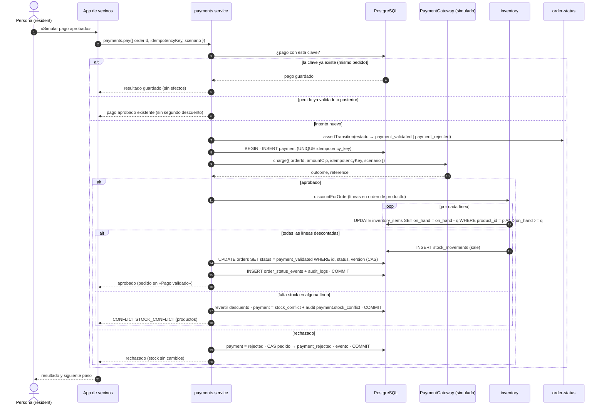

# Pagos simulados

> Módulo: `packages/api/src/modules/payments` · Historias: HU-05, HU-06 · Issues: #14, #15 · Estado: Borrador v1 (Sprint 1)

## 1. Propósito

Simular el pago de un pedido confirmado, con respuesta controlada de aprobación o rechazo, sin dinero ni servicios externos (Inception §4.1 punto 4, §4.4), y coordinar de forma **consistente e idempotente** el pago, el estado del pedido y el stock (RF-07, RNF-08, riesgo R-04).

## 2. Actores y roles

| Actor             | Participa                                                            |
| ----------------- | -------------------------------------------------------------------- |
| `resident` dueño  | Ejecuta el pago simulado de su pedido y ve el resultado.             |
| `system`          | Registra el resultado: transición del pedido, descuento y auditoría. |
| Pasarela simulada | `SimulatedPaymentGateway`, adaptador del puerto `PaymentGateway`.    |

## 3. Reglas de negocio

1. **R-PAY-01.** La lógica de negocio depende solo del puerto `PaymentGateway.charge({ orderId, amountClp, idempotencyKey, scenario }) → { outcome: "approved" | "rejected", reference }`. El adaptador `SimulatedPaymentGateway` devuelve el escenario elegido (`approve` → `approved`, `reject` → `rejected`) y una referencia `SIM-<aleatorio>`. Reemplazarlo por una pasarela real no cambia el servicio. _(RF-06, RNF-11, D-13)_
2. **R-PAY-02.** Solo el dueño paga, y solo pedidos en `pending_payment` o `payment_rejected`. Un pedido de otra cuenta o inexistente → `NOT_FOUND` (D-10); en `draft` o `cancelled` → `CONFLICT` (`ORDER_NOT_PAYABLE`). _(RF-07, RNF-05)_
3. **R-PAY-03.** El monto es el `total_clp` confirmado del pedido; el cliente no envía montos. _(RF-07, R-ORD-11)_
4. **R-PAY-04.** Cada intento lleva una `idempotencyKey` (UUID generado por el cliente una vez por intento y reutilizado si ese intento se repite). Si ya existe un pago con esa clave **para el mismo pedido**, se devuelve el resultado guardado sin ningún efecto; si la clave pertenece a otro pedido → `CONFLICT` (`IDEMPOTENCY_KEY_REUSED`). La unicidad la garantiza la BD (`UNIQUE (idempotency_key)`), también ante solicitudes concurrentes. El resultado repetido conserva el `outcome` guardado y trae el estado **actual** del pedido; el `message` original solo se repite mientras sigue siendo cierto (aprobado y el pedido sigue en `payment_validated`; rechazado y el pedido aún se puede pagar). Si el pedido avanzó desde entonces (cancelado, pagado con otra clave, en preparación…), el mensaje dice qué pasó con ese intento y en qué estado está ahora el pedido. _(HU-05 criterio 3, RNF-08, RNF-09, D-12)_
5. **R-PAY-05.** Si el pedido ya está en `payment_validated` o un estado posterior, se devuelve el pago aprobado existente: **nunca** hay un segundo descuento por el mismo pedido. _(HU-05 criterio 3, RNF-08, D-12)_
6. **R-PAY-06.** Pago **aprobado** con stock suficiente: en **una sola transacción** se registra el pago `approved`, se descuenta el stock de todas las líneas (ver [Inventario](./inventory.md)), se escriben los movimientos `sale`, el pedido pasa a `payment_validated` (_compare-and-set_), se escribe el `OrderStatusEvent` (`system`) y la auditoría. Si cualquier paso falla, no queda nada aplicado. _(HU-05 criterio 1, HU-06 criterio 1, RF-07, D-02)_
7. **R-PAY-07.** Pago **rechazado**: se registra el pago `rejected`, el pedido pasa a `payment_rejected` y el stock **no cambia**. La respuesta informa el rechazo y cómo continuar («Tu pago simulado fue rechazado. Puedes intentarlo de nuevo o cancelar el pedido.»). _(HU-05 criterio 2, RF-08, RNF-09)_
8. **R-PAY-08.** Desde `payment_rejected` se puede reintentar con una **nueva** clave (D-11).
9. **R-PAY-09.** Conflicto de stock: si al aprobarse el pago alguna línea no tiene stock suficiente (otra operación consumió el último stock), el descuento se revierte completo (sin descuentos parciales), se registra el pago como `stock_conflict` y un `AuditLog` `payment.stock_conflict` con los productos (solicitado vs. disponible), el pedido **conserva su estado** y la persona recibe `CONFLICT` (`STOCK_CONFLICT`) con la lista de productos y el mensaje «No hay stock suficiente de: …. Tu pedido sigue pendiente; puedes intentarlo más tarde o cancelarlo.». _(HU-06 criterio 2, RNF-08, D-09)_
10. **R-PAY-10.** Repetir una clave cuyo intento terminó en `stock_conflict` devuelve el mismo `CONFLICT` sin efectos; un nuevo intento requiere una nueva clave. _(D-12)_
11. **R-PAY-11.** Concurrencia: N pagos simultáneos de pedidos distintos que compiten por las últimas unidades validan exactamente los pedidos factibles; el stock nunca queda negativo. N solicitudes simultáneas con la misma clave producen un solo descuento. _(RNF-08, indicador “Consistencia pedido-stock”)_
12. **R-PAY-12.** Ningún registro guarda datos de tarjetas ni datos reales; la referencia del simulador es sintética. _(RNF-06, §4.4)_

Nota sobre el simulador: la pasarela se consulta antes de descontar. Con una pasarela real (fuera de alcance, §4.4) un `stock_conflict` exigiría anular o reembolsar el cobro; ese contrato se documentará al evaluar una integración (riesgo R-11).

## 4. Estados y transiciones

Estado del intento de pago (`payments.status`): `approved`, `rejected`, `stock_conflict` (un intento no cambia de estado después de registrado). Transiciones del pedido que dispara: T2–T5 de [Estados del pedido](./order-status.md).



Fuente PlantUML: [`docs/uml/payment-sequence.puml`](../uml/payment-sequence.puml).

## 5. API

| Procedimiento  | Tipo     | Acceso                      | Entrada                                                                               | Salida          | Errores                                                                                                                                                |
| -------------- | -------- | --------------------------- | ------------------------------------------------------------------------------------- | --------------- | ------------------------------------------------------------------------------------------------------------------------------------------------------ |
| `payments.pay` | mutation | `residentProcedure` (dueño) | `{ orderId: string, idempotencyKey: string (uuid), scenario: "approve" \| "reject" }` | `PaymentResult` | `UNAUTHORIZED`, `FORBIDDEN`, `BAD_REQUEST`, `NOT_FOUND`, `CONFLICT` (`ORDER_NOT_PAYABLE`, `STOCK_CONFLICT`, `IDEMPOTENCY_KEY_REUSED`, `STALE_VERSION`) |

```ts
type PaymentResult = {
  paymentId: string;
  outcome: "approved" | "rejected";
  reference: string;
  replayed: boolean; // true si se devolvió un resultado guardado (R-PAY-04/05)
  order: { id: string; code: string; status: OrderStatus; statusLabel: string; version: number };
};
// CONFLICT STOCK_CONFLICT → details: { reason: "STOCK_CONFLICT", products: { productId, commercialName, requested, available }[] }
```

API interna (vía `index.ts`): `type PaymentGateway`, `createSimulatedPaymentGateway()`. El gateway se inyecta como dependencia del servicio (los tests usan uno falso).

## 6. Datos

`payments`: `id` PK, `order_id` FK → `orders` (`RESTRICT`), `idempotency_key` UNIQUE, `amount_clp` (`Int > 0`), `status` (`approved | rejected | stock_conflict`, `CHECK`), `reference` (nulo), `failure_reason` (nulo), `created_at`. Índice `(order_id, created_at)`. Recomendado como red de seguridad: índice único parcial `payments(order_id) WHERE status = 'approved'` (un solo pago aprobado por pedido, RNF-08).

## 7. Casos de prueba

| ID      | Nivel | Caso                                                                                                                                                                                                                                                           | Criterio cubierto        | Archivo esperado                                                                                                                                                          |
| ------- | ----- | -------------------------------------------------------------------------------------------------------------------------------------------------------------------------------------------------------------------------------------------------------------- | ------------------------ | ------------------------------------------------------------------------------------------------------------------------------------------------------------------------- |
| PAY-U01 | unit  | Simulador: `approve` → `approved`, `reject` → `rejected`, referencia `SIM-…`                                                                                                                                                                                   | RF-06                    | `packages/api/src/modules/payments/simulated-payment-gateway.test.ts`                                                                                                     |
| PAY-U02 | unit  | Servicio con repos y gateway falsos: aprobado → `payment_validated` + descuento solicitado + confirmación                                                                                                                                                      | HU-05 #1                 | `packages/api/src/modules/payments/payments.service.test.ts`                                                                                                              |
| PAY-U03 | unit  | Rechazado → `payment_rejected`, inventario no invocado                                                                                                                                                                                                         | HU-05 #2                 | `packages/api/src/modules/payments/payments.service.test.ts`                                                                                                              |
| PAY-U04 | unit  | Clave repetida → resultado guardado, gateway e inventario no invocados                                                                                                                                                                                         | HU-05 #3                 | `packages/api/src/modules/payments/payments.service.test.ts`                                                                                                              |
| PAY-U05 | unit  | Pedido ya validado → pago existente; pedido ajeno → `NOT_FOUND`; `draft`/`cancelled` → `CONFLICT`                                                                                                                                                              | R-PAY-02, R-PAY-05       | `packages/api/src/modules/payments/payments.service.test.ts`                                                                                                              |
| PAY-U06 | unit  | Schema: `idempotencyKey` no UUID o escenario desconocido → `BAD_REQUEST`                                                                                                                                                                                       | R-PAY-04                 | `packages/api/src/modules/payments/payments.schema.test.ts`                                                                                                               |
| PAY-U07 | unit  | Clave repetida después de que el pedido cambió (pagado con otra clave, cancelado) → mensaje según el estado actual, sin invitar a pagar de nuevo ni prometer preparación                                                                                       | R-PAY-04, RNF-09         | `packages/api/src/modules/payments/payments.errors.test.ts`, `packages/api/src/modules/payments/payments.service.test.ts`                                                 |
| PAY-U08 | unit  | Cliente: resultado desconocido sin culpar a la conexión (5xx, 408, 429, red); recordatorio del intento sin confirmar; el resultado y su «Reintentar» siguen visibles si falla la recarga del pedido                                                            | HU-05 #3, RNF-09, D-12   | `apps/mobile/src/features/payment/payment-outcome.test.ts`, `apps/mobile/src/features/payment/payment-attempts.test.ts`, `apps/mobile/src/lib/cached-query-state.test.ts` |
| PAY-I01 | int   | Aprobado descuenta una vez y escribe pago, movimientos, evento y auditoría en una transacción                                                                                                                                                                  | HU-05 #1, HU-06 #1       | `packages/api/src/modules/payments/payments.int.test.ts`                                                                                                                  |
| PAY-I02 | int   | Rechazado no cambia `on_hand` ni escribe movimientos                                                                                                                                                                                                           | HU-05 #2, RF-08          | `packages/api/src/modules/payments/payments.int.test.ts`                                                                                                                  |
| PAY-I03 | int   | Misma clave dos veces (secuencial y concurrente) → un solo descuento                                                                                                                                                                                           | HU-05 #3, RNF-08         | `packages/api/src/modules/payments/payments.concurrency.int.test.ts`                                                                                                      |
| PAY-I04 | int   | 20 pagos concurrentes por las últimas unidades → solo los factibles se validan; stock nunca negativo                                                                                                                                                           | HU-06 #2, RNF-08         | `packages/api/src/modules/payments/payments.concurrency.int.test.ts`                                                                                                      |
| PAY-I05 | int   | `stock_conflict`: pedido conserva su estado, pago `stock_conflict` y auditoría con productos                                                                                                                                                                   | HU-06 #2                 | `packages/api/src/modules/payments/payments.int.test.ts`                                                                                                                  |
| PAY-I06 | int   | Reintento tras rechazo con nueva clave → `payment_validated`                                                                                                                                                                                                   | R-PAY-08                 | `packages/api/src/modules/payments/payments.int.test.ts`                                                                                                                  |
| PAY-E01 | e2e   | Pago aprobado en la web de la app → pantalla de confirmación y estado «Pago validado»                                                                                                                                                                          | HU-05 #1                 | `apps/e2e/src/mobile-web/resident-order.spec.ts`                                                                                                                          |
| PAY-E02 | e2e   | Pago rechazado → mensaje de rechazo; stock verificado por API sin cambios. Reintentos desde la app: cada intento nuevo tras un rechazo usa una clave nueva; si se pierde la respuesta de un aprobado, «Reintentar» reusa la clave y el stock baja una sola vez | HU-05 #2, #3; D-11, D-12 | `apps/e2e/src/mobile-web/payment-rejected.spec.ts`                                                                                                                        |

## 8. Trazabilidad

| Requisito | Historia     | Reglas                           | Pruebas                                     |
| --------- | ------------ | -------------------------------- | ------------------------------------------- |
| RF-06     | HU-05        | R-PAY-01, R-PAY-12               | PAY-U01, PAY-E01, PAY-E02                   |
| RF-07     | HU-05, HU-06 | R-PAY-02..06, R-PAY-11           | PAY-U02, PAY-U04, PAY-U05, PAY-I01, PAY-I03 |
| RF-08     | HU-05        | R-PAY-07                         | PAY-U03, PAY-I02, PAY-E02                   |
| RNF-08    | HU-05, HU-06 | R-PAY-04, R-PAY-05, R-PAY-09..11 | PAY-I03, PAY-I04, PAY-I05                   |
| RNF-09    | HU-05, HU-06 | R-PAY-07, R-PAY-09               | PAY-E02                                     |
| RNF-11    | HU-05, HU-06 | R-PAY-01                         | PAY-U01, PAY-U02 (gateway falso)            |

## 9. Notas de implementación (Sprint 1, PR #37)

- **Orden dentro de la transacción:** (1) `SELECT … FOR UPDATE` del pedido (serializa intentos y duplicados del mismo pedido), (2) dueño o `NOT_FOUND`, (3) búsqueda por `idempotency_key` (replay sin efectos o `IDEMPOTENCY_KEY_REUSED`), (4) pedido ya pagado ⇒ pago aprobado existente, (5) estado pagable o `ORDER_NOT_PAYABLE`, (6) `PaymentGateway.charge`, (7) `INSERT payment` con el resultado. A diferencia del diagrama, el pago se inserta **después** de consultar la pasarela, porque `payments.status` no admite un estado "pendiente"; la unicidad de la clave sigue protegiendo los duplicados concurrentes (la transacción perdedora falla con `P2002`, se reintenta una vez y responde con el resultado guardado o `IDEMPOTENCY_KEY_REUSED`).
- **`stock_conflict`:** el pago se inserta como `approved`, el descuento detecta el conflicto bajo bloqueo sin modificar nada y, en la misma transacción, el pago pasa a `stock_conflict` y se escribe `AuditLog payment.stock_conflict`; luego se responde `CONFLICT STOCK_CONFLICT`.
- **`PaymentResult.message`:** texto en español de lo ocurrido y cómo continuar (RNF-09), además de `outcome`.
- **Cliente (`apps/mobile`):** el estado del intento vive sobre la consulta del pedido, así que una recarga fallida (servidor inalcanzable justo tras un resultado desconocido) muestra un aviso «No pudimos actualizar el pedido» sin perder el resultado ni su «Reintentar» con la misma clave (D-12). El mensaje de resultado desconocido no atribuye la causa a la conexión (puede ser 5xx o 429) y pide esperar un momento antes de reintentar. Si se vuelve a la pantalla con un intento sin confirmar, se recuerda que repetir ese escenario es seguro.
- **Composición:** el router usa `createSimulatedPaymentGateway()`; el servicio solo conoce el puerto `PaymentGateway` (RNF-11).
